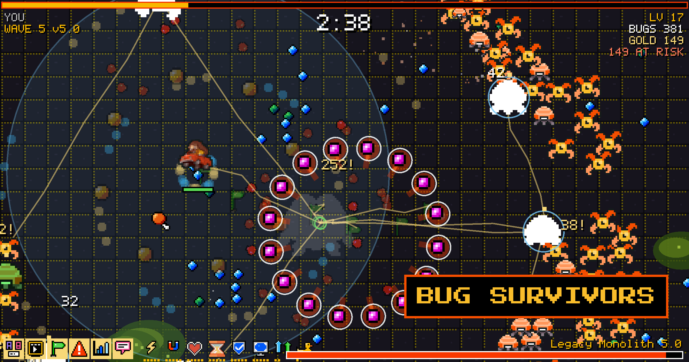

<p align="center">
  
</p>

# Bug Survivors

A small arcade survival game about squashing bugs, and the tool we use to make a custom copy of it for each company we talk to.

You play a PostHog hedgehog in an arena. Bugs come from every direction, you only move, and your weapons fire on their own. Each weapon is a
PostHog product. Level up, pick upgrades, evolve what you've got, and try to take down the Legacy Monolith at 3:30. Then decide whether to cash
out or push on to the next wave.

**Play it: [survivors.posthog.com](https://survivors.posthog.com)**. It's free, needs no sign-up, and works on a phone. The
[guide](https://survivors.posthog.com/guide) has every weapon, bug and number.

## Making a game for a prospect

Sign in at `/admin` with your PostHog account (only verified `@posthog.com` emails get in), create a game for a company, and talk to the
assistant. It reads the company's website, picks brand colours, renames the bugs and the boss, and redraws the sprites. You watch the game
change in a live preview next to the chat. Upload a logo and it's turned into pixel art in your browser; you pick one of four.

When you're done you get a link and a password. The link is public but not indexed, and nothing about the game is served until the password
is entered. Passwords are shown once and can be reset from the admin.

You bring your own Anthropic or OpenAI key. It's kept in your browser's `localStorage`, goes to the Worker in a header with each chat message,
is used for that request and is never stored or logged.

## How it's built

One Cloudflare Worker, one D1 database, and the game as static assets.

| Path | What |
|---|---|
| `/` | The default game and its guide. Static assets, so the Worker never wakes up for them. |
| `/g/<slug>/` | A prospect's game, behind its password. |
| `/admin`, `/api/*` | The admin app and its JSON API. Signed-in PostHog people only. |
| `/oauth/*` | Sign in with PostHog (OAuth with PKCE; the app identifies itself with a client ID metadata document at `/oauth/client.json`). |
| `/mp/lb/<board>` | Leaderboards, top 20 per game. |

A game is rows in D1, not files: a theme (JSON) and the sprites the assistant redrew, stored as small text grids. The Worker answers the three
URLs the game already fetches (`theme.json`, `manifest.json`, `sprites/<slot>.png`) from those rows and renders sprites to PNG on demand. Sprites
nobody redrew are the stock art, recoloured to the brand palette, and match what the original Python tooling produces pixel for pixel (there's a
test for that).

The assistant is an [AI SDK](https://ai-sdk.dev) agent that runs in the Worker. Its tools edit the game through the same validation the admin API
uses, and the ones that draw something hand the picture back to the model, so it can look at a sprite, see it's muddy, and fix it.

The stack: [Hono](https://hono.dev), D1 with [Drizzle](https://orm.drizzle.team), Zod, React 19 with Vite, Tailwind 4, shadcn/ui and AI Elements
for the admin, Phaser for the game, [Biome](https://biomejs.dev), Vitest (running in the Workers runtime) and Playwright.

```
src/          the Worker: routes/, agent/, db/ (schema and queries), lib/ (gate, sign-in, theme rules, sprite rendering)
admin/        the admin app (its own npm workspace)
game/         the game's source and build (its own npm workspace)
migrations/   SQL, generated from src/db/schema.ts
scripts/      build assembly (headers, CSP, robots.txt, sitemap), seed data, end-to-end runner
test/         node/ (sprite and theme logic), worker/ (the Worker in workerd), and the Playwright tests
```

## Running it locally

You need Node 22+. [uv](https://docs.astral.sh/uv/) is only needed for the browser tests and for regenerating the stock art.

```sh
npm install
cp .dev.vars.example .dev.vars   # DEV_LOGIN_EMAIL signs you in on localhost without going through PostHog
npm run build                    # the game and the admin app into public/
npm run db:migrate
npx tsx scripts/seed-dev.mts > /tmp/seed.sql && npx wrangler d1 execute survivors --local --file /tmp/seed.sql
npm run dev                      # http://localhost:8787
```

The admin is at `/admin`. The seed adds a game at `/g/ledgerly-test1/` with the password `otter-maple-42`.

```sh
npm run check        # Biome and TypeScript for everything
npm test             # builds, then runs Vitest
npm run e2e          # starts the Worker and a fake AI provider, drives the whole thing in a browser
npm run dev:admin    # Vite dev server for the admin app, talking to `npm run dev`
npm run dev:game     # Vite dev server for the game on its own
```

After editing `src/db/schema.ts`, run `npm run db:generate` and commit the migration. After editing the game's sprites or `GUIDE.md`, run
`npm run art` or `npm run guide`.

## Deploying

1. `npx wrangler d1 create survivors`, put the `database_id` in `wrangler.jsonc`, then `npx wrangler d1 migrations apply survivors --remote`.
2. Set the secrets: `npx wrangler secret put SESSION_SECRET` (a long random string) and `LB_ADMIN`.
3. `npm run deploy`.

`wrangler.jsonc` attaches the Worker to `survivors.posthog.com` as a Custom Domain. For that to work the `posthog.com` zone has to be in the
same Cloudflare account as the Worker, and the hostname can't already have a DNS record. `workers_dev` is off on purpose: PostHog's OAuth client
ID is the Worker's origin, so it should only ever answer on one.

After the first deploy, sign in once at `/admin`. PostHog fetches `/oauth/client.json` to find out who is asking, and that's the one part that
can't be tested without the real domain.

## Good to know

- **Search engines.** The home page and the guide are indexable and carry the usual tags: canonical URL, Open Graph and Twitter cards, and JSON-LD
  (`VideoGame`, `Organization`, `WebSite`; `TechArticle` on the guide). Everything else answers with `X-Robots-Tag: noindex`, and a prospect's
  game has those tags stripped out. `robots.txt` doesn't block anything, because a crawler that can't fetch a page never sees its `noindex`.
- **Content-Security-Policy.** `script-src 'self'` everywhere, with one exception: the guide has a single inline script, allowed by its hash on
  `/guide` only. The admin app can only connect to its own origin; the browser never talks to an AI provider directly.
- **Who can edit what.** Anyone signed in can see and change every game. Each game records who made it.
- **Website reading.** The assistant's `fetch_page` tool only talks to public http(s) hosts on the default ports, re-checks every redirect, and
  limits size, time and the number of pages per reply.
- **Cost.** 20 chat messages a minute per person, 30 steps and five minutes per reply, and only the three newest images in a conversation are sent
  back to the model.
- **Analytics.** Set `posthog` in `game/site.json` and rebuild to send the games' events to a PostHog project.

The security-relevant behaviour (password gate, email-domain check, key redaction, SSRF rules, tool ordering) has tests that fail when you remove the
code they cover. If you change any of that, check the tests still fail when they should.

## What hasn't been tried against the real thing

- The full PostHog sign-in. It's tested against a mock of PostHog's token and userinfo endpoints, but not end to end.
- The OpenAI path. The Anthropic one runs in the end-to-end test against a scripted fake of its streaming API; the OpenAI one is wired the same way
  but hasn't talked to OpenAI.
- How good real models are at pixel art, and Workers CPU time and D1 under load.

## Credits

The game is Bug Survivors from [CEMcNEill/games](https://github.com/CEMcNEill/games), copied at
[`551915f`](https://github.com/CEMcNEill/games/commit/551915f09ac3b5e736b673ba833527e2b4341d04). From there it's maintained here:
[`game/UPSTREAM.md`](game/UPSTREAM.md) lists what was left behind and what changed (no co-op, a self-hosted font for the guide).

## License

[MIT](LICENSE).
